# Legend of Maten (Super Famicom) English translation v1.0

An unofficial fan translation patch for **Maten Densetsu: Senritsu no Ooparts**
(魔天伝説 戦慄のオーパーツ), the game whose own title screen calls it LEGEND OF MATEN.
It contains only the changes to the game, not the game: you need your own ROM of
**Maten Densetsu - Senritsu no Ooparts (Japan)**.

Maten Densetsu is a science-fiction RPG set in a Japan that has been torn off the Earth and
thrown into space. You pick one of five heroes, make your weapons out of your own mind, and
travel a ruined country with a heroine who has psychic powers and with monsters who have
joined you.

**[Download the patch (v1.0)](https://github.com/suddenlythis/maten-densetsu-snes-english/releases/tag/v1.0)**
 · [How to install](INSTALL.md) · [Checksums](SHA1SUMS.txt)

  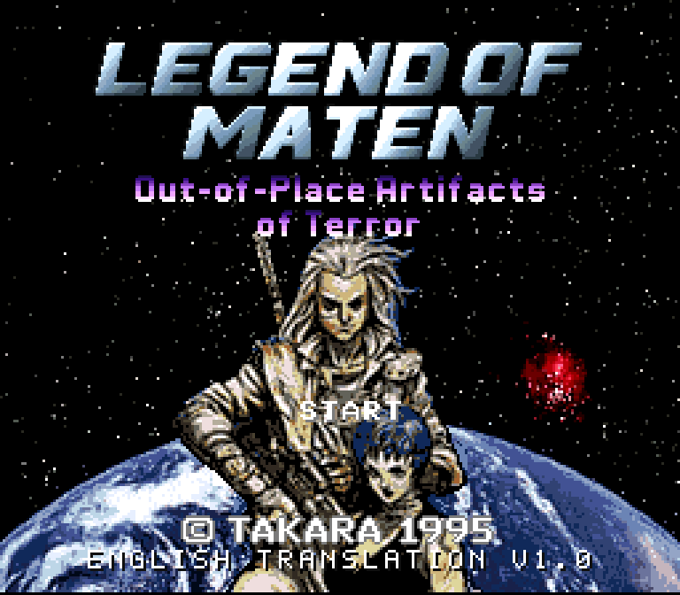

## Progress

Version 1.0: the script, the battle text and the pictures with text are translated.

| Area | Status | Details |
|---|---|---|
| English text system | Done | The game drew every character 12 pixels wide and broke lines wherever they ran out. The patch gives each letter its own width and breaks lines between words |
| Dialogue and narration | Done | All of it: the five heroes' routes, every event, the ending and the credits. About 4,200 messages in all, battle and menu text included |
| Battle text | Done | Attack, damage, status, ESP and item sentences, put into English word order |
| Names and lists | Done | Heroes, heroines, ally monsters, enemies, weapons, items, ESP powers, OOPArts and the place names on the save screen |
| Title screen | Done | A new English logo and subtitle in the style of the Japanese ones |
| Menus and system text | Done | Most labels were already in English. The config screen's title and its help text are translated |
| Name entry | Done | Opens on the letters page. Names of up to 6 letters |
| Tested on | Mesen 2.1.1 | Not tested in other emulators or on real hardware |

## About the game

| | |
|---|---|
| Released | October 1995, Japan only |
| Publisher | Takara |
| Platform | Super Famicom |
| Product code | SHVC-AZ9J-JPN |
| Staff, as the credits spell them | Scenario: Masaru Takeuchi. Character design: Katsuya Terada. Creature design: Yasushi Nirasawa, Yusuke Takayanagi |

**The story.** Near the end of the 21st century a space-time upheaval tears Japan, islands and
all, away from the Earth and throws it into space. Shinjuku, the new centre of Tokyo, lies in
ruins, monsters walk the streets, and ruins from every age of history have appeared across
the country. The hero wakes in the laboratory of Dr. Akihi with a glowing orb in his hand and
the memory of a woman's voice telling him to come to Shinjuku.

**How it plays.** There are no levels and no shops. Defeated monsters leave energy (ENG),
and you spend it on your own stats, on rebuilding your weapon, on copies of items you have
found once, or on the heroine. Only the hero makes weapons, a sword or a gun, by picturing
them. The heroine fights with ESP powers, each with five boost levels. Monsters you meet can
join you: up to two fight beside you, and a third waits in stock as a crystal. You cross
the country on a field map and explore ruins in first-person 3D with an auto-map. Many
events turn on choices, and some choices close others off for good.

**OOPArts.** An "out-of-place artifact" is an object that could not have been made in the
age it was found in. The manual gives the crystal skull as the best-known example. Eight
OOPArts appear in the game.

## Screenshots

| | |
|---|---|
| 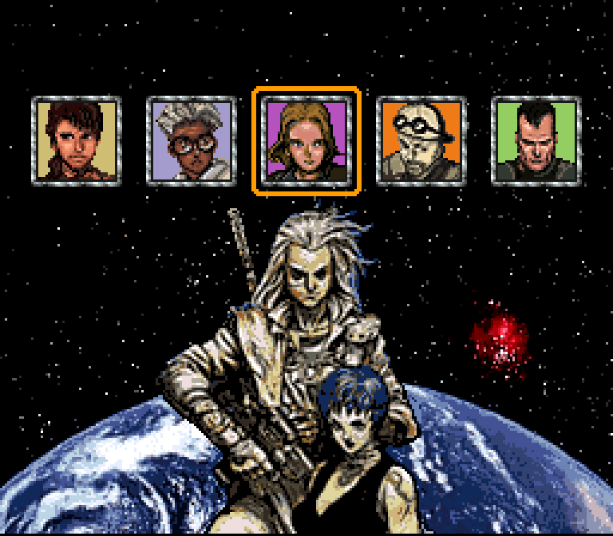 | 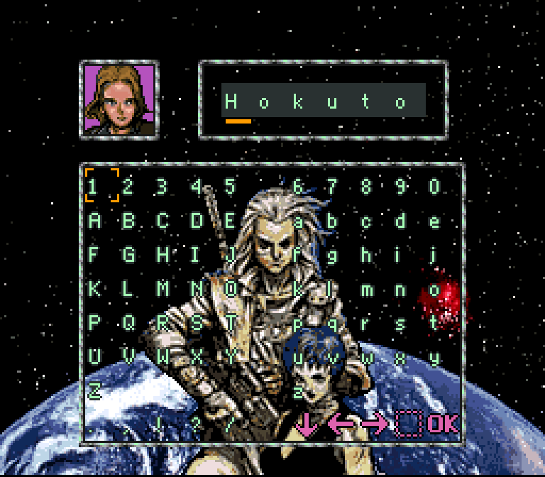 |
| 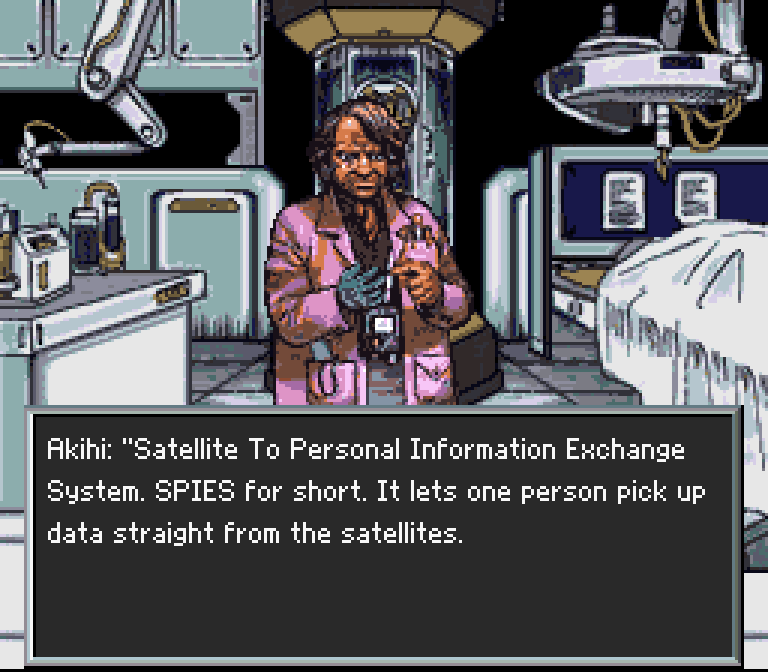 | 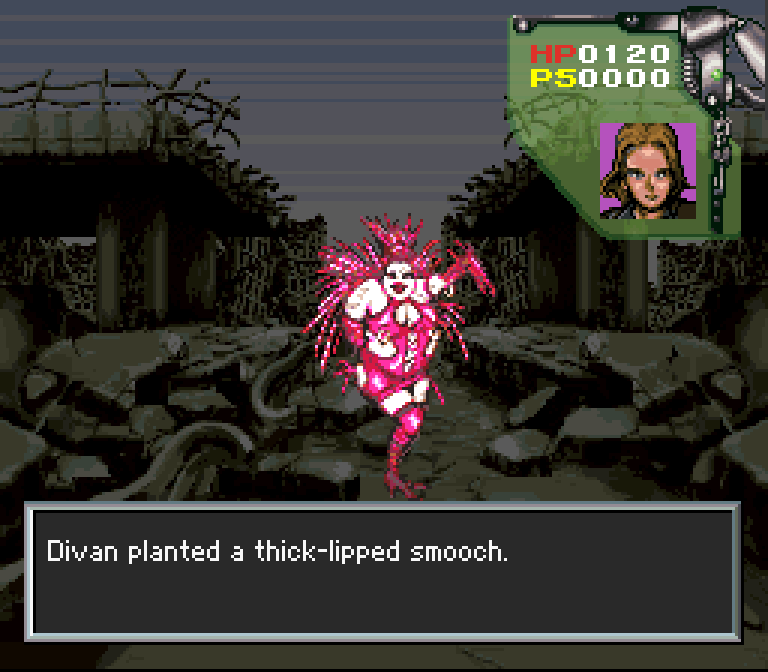 |
| 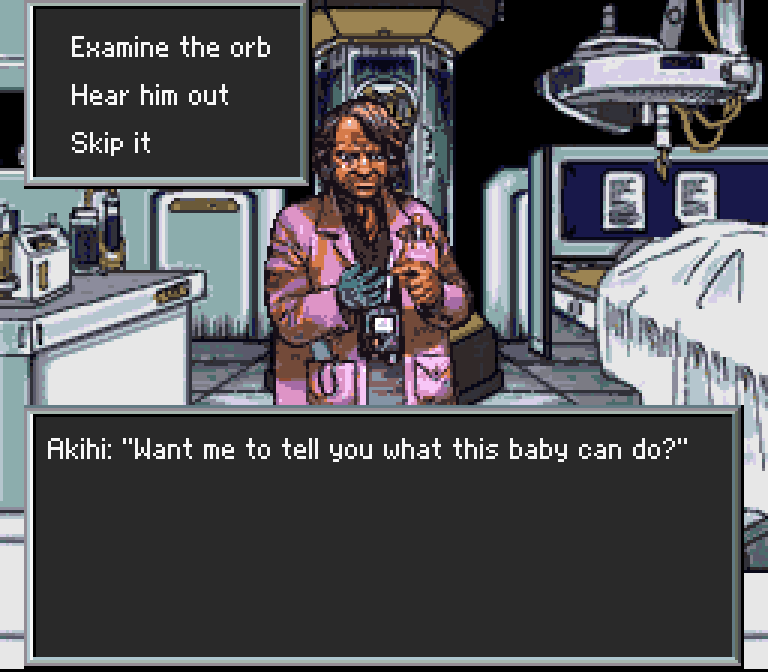 | 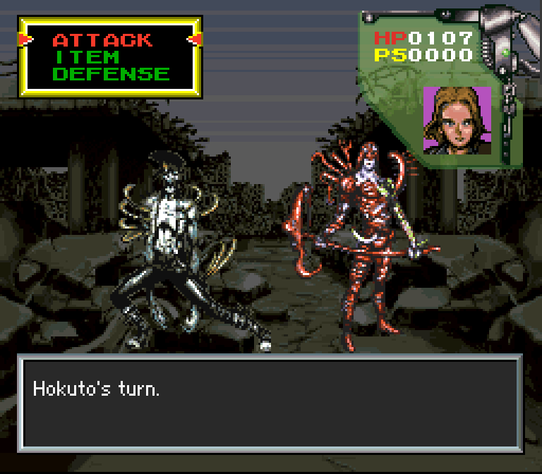 |
| 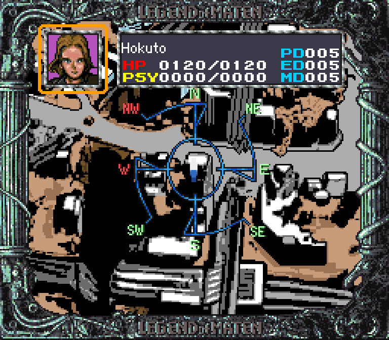 | 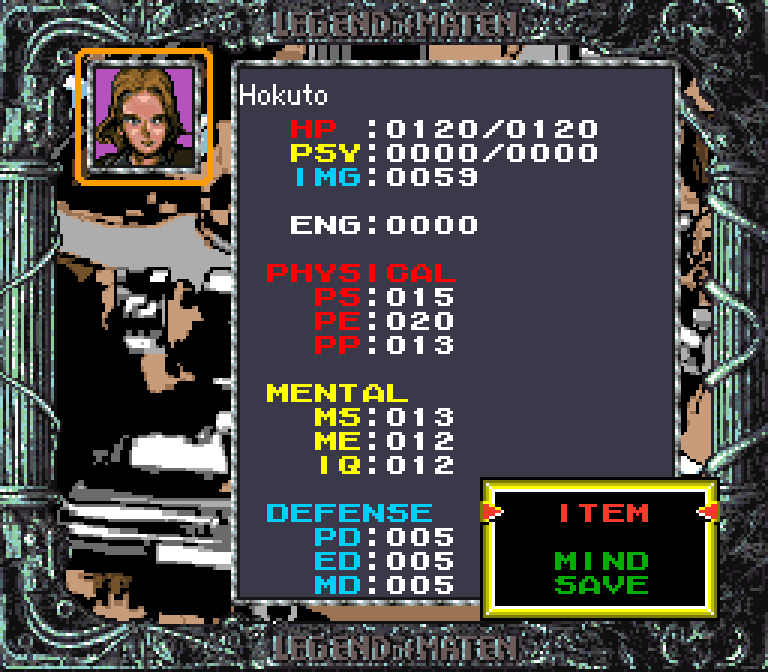 |
| 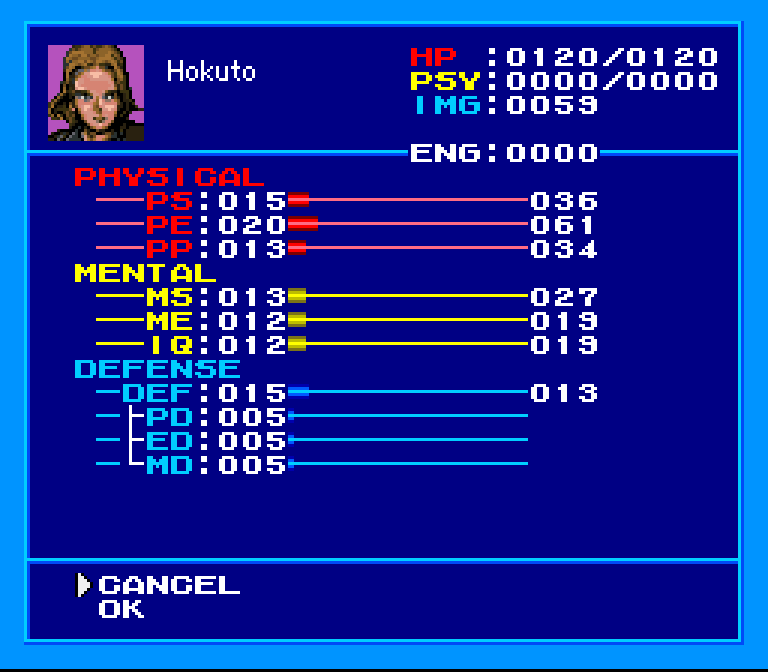 | 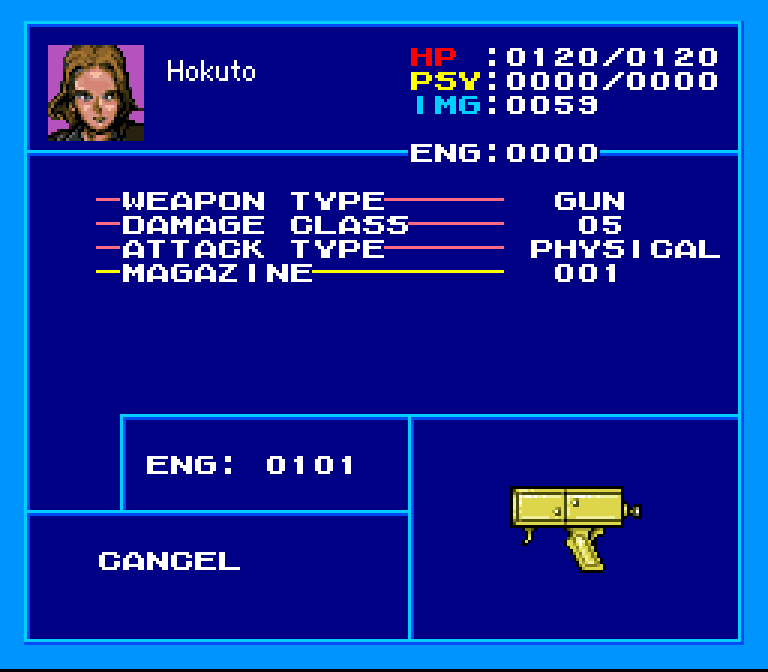 |
| 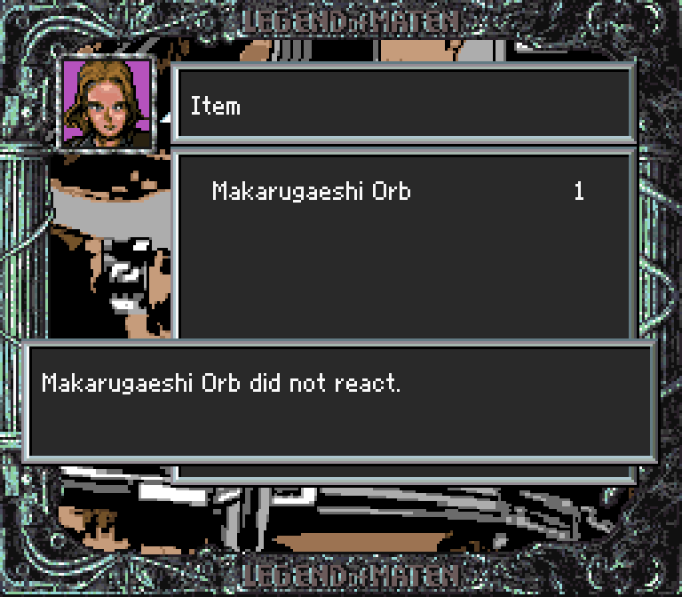 | 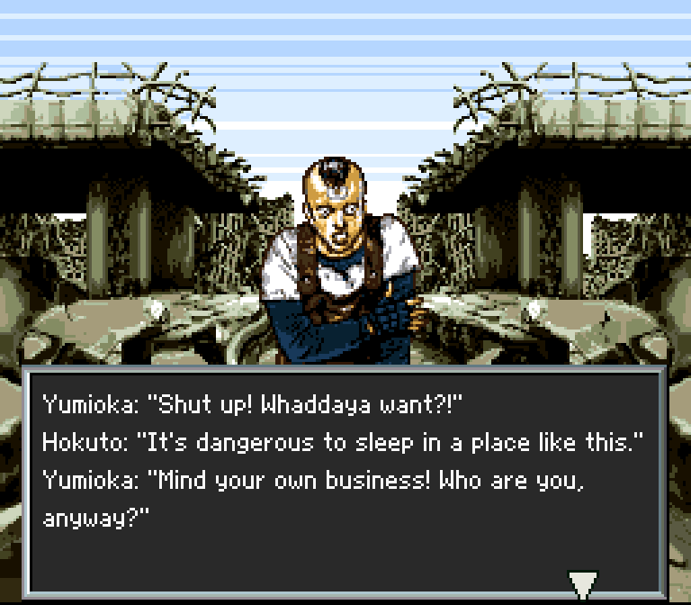 |
| 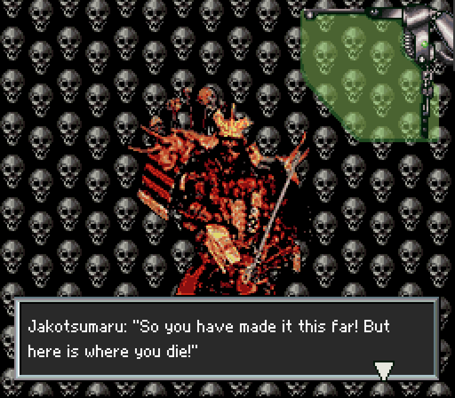 | 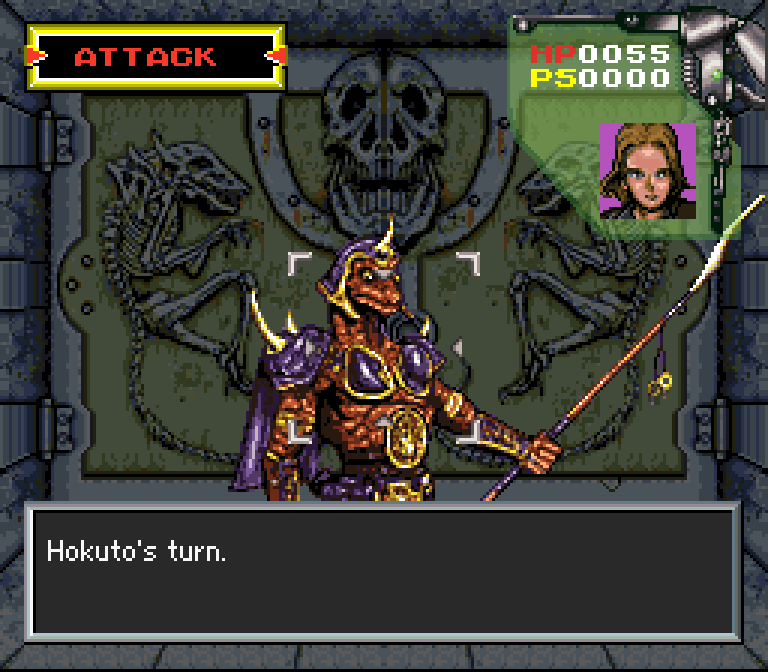 |
| 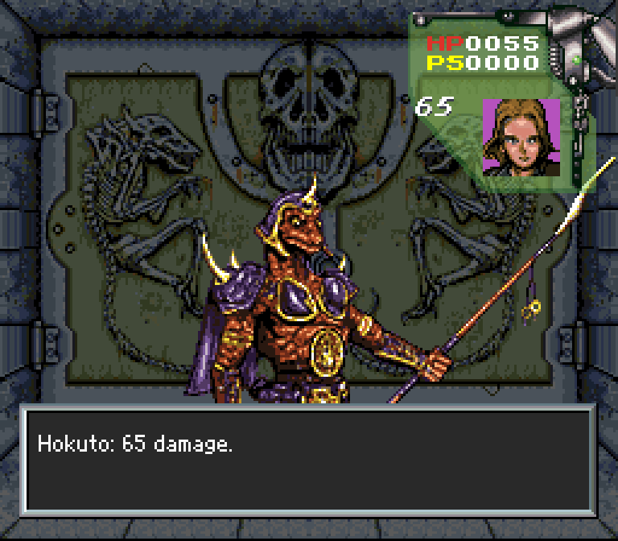 | 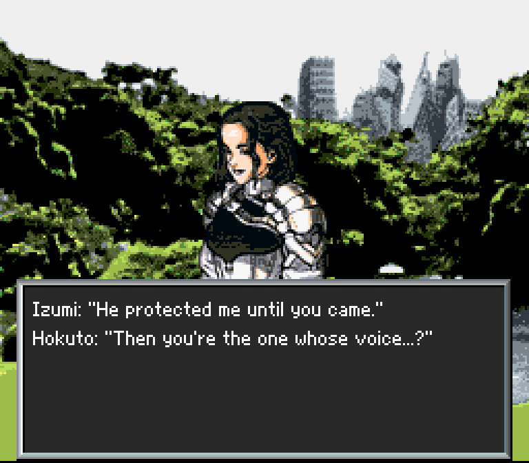 |
| 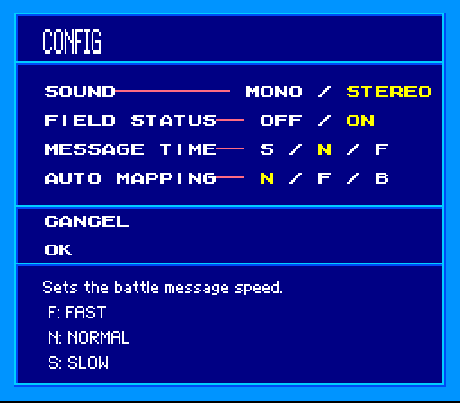 | 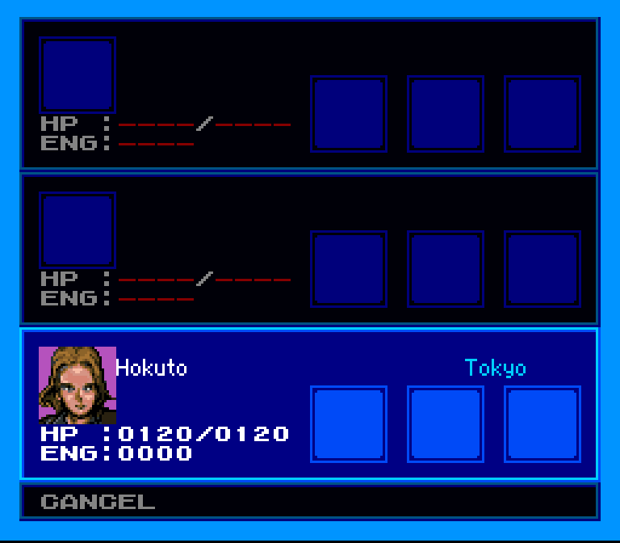 |
| 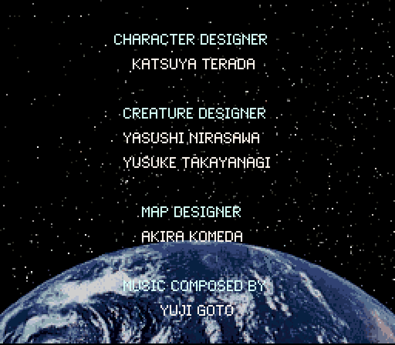 | |

## Installing

You need the ROM **Maten Densetsu - Senritsu no Ooparts (Japan)**, with no copier header:

| | |
|---|---|
| Size | 3,145,728 bytes |
| CRC32 | `0F02330F` |
| SHA-1 | `64d3f337e06fa33eb012c98169426a92e4058f1f` |

Short version: apply `MatenDensetsu-EN-v1.0.bps` to that ROM with Floating IPS, or with Rom Patcher JS in
a web browser, and play the file it writes. The patcher refuses any other ROM.

The full steps are in [INSTALL.md](INSTALL.md).

Start a new game after patching. A save made with the Japanese game keeps its names in
Japanese letters, and was not tested with the patch.

## About this translation

**The title.** LEGEND OF MATEN is the game's own English title: it was already printed in
small letters on the Japanese title screen and on the cover of the manual. The patch makes
it the logo.
魔天 (maten) is left as a name.

**The subtitle.** 戦慄のオーパーツ is "OOPArts of terror". Because few people know the word
OOPArts, the title screen writes it out: "Out-of-Place Artifacts of Terror". Inside the game
the word OOPArts is used, as the characters use it.

**Tone.** The script keeps the tone of the original: pulp science fiction and occult
mystery.

**Names.** People's names are given name first (Tosuke Akihi, Hokuto Mizuki). Names from
Japanese folklore are kept as they are (Shikigami, Hibagon, Fujin, Raijin, the
Makarugaeshi Orb).

**No honorifics.** There are no Japanese honorifics. The relationship is carried by the
wording instead.

**Spelling.** American English, to match the labels the game already had (DEFENSE).

AI was used to assist with the code and translation.

## What is in English

- All dialogue and narration, in every hero's route, with each character's voice kept.
- Battle text: turns, attacks, damage, status effects, ESP, items, victory and defeat.
- The names of the heroes, heroines, ally monsters, enemies, weapons, items, ESP powers
  and OOPArts, and the place names on the save screen.
- The help text of the config screen.
- The ending and the credits. The staff names were already in Latin letters.
- Pictures with text, redrawn in English:
  - the title logo
  - the subtitle under it
  - the title of the config screen

## What was changed in the game

Nothing about the rules, the story or the content was changed.

Text
- Letters have their own widths (the game drew every character 12 pixels wide), and lines
  break between words. A word is never split, including the first word of a sentence that
  the game puts together from several pieces, such as a name and a weapon.
- Every dialogue window was checked against its English text and made taller where the
  text needed more lines. The game does not scroll text, so each window has to hold its
  whole page.
- Battle sentences were re-ordered for English ("Hokuto: 12 damage.").
- In the scenes that play inside battles, a speaker's name is followed by a colon. The
  Japanese puts the quotation bracket straight after the name.

Interface
- The name-entry screen opens on the letters page. The two kana pages are still there:
  the X Button changes page.
- The title screen shows the version of the translation under the copyright line.

Technical
- The ROM grows from 3 MB to 4 MB to make room for the English text. The cartridge
  header already declared 4 MB.

## Not translated

- A station sign inside one backdrop, the subway entrance, and its overgrown version.
  The game is set in Japan and the sign is part of the scenery.
- The kana pages of the name-entry screen.

## Known issues and limits

- A hero name typed in kana can be wider than six letters, so a few lines may wrap one
  word earlier than intended.
- One enemy's battle cry is longer than a line of the battle window and continues on the
  second line. It does in Japanese too.
- The menu font's capital C looks like a G at small sizes ("CANCEL"). That is the
  original font.

If you find a problem, please open an issue and say where in the game it happened.

## Technical

- The patch is a BPS file. It checks the ROM before and after patching and refuses a ROM
  that is not the one above.
- The patched ROM is 4,194,304 bytes, CRC32 `5CFC6DA1`, SHA-1 `abb502dcd1a1656c46f3cffbbf6c502ff08d8366`. Its internal
  checksum is valid. It uses the same save memory as the original (8 KB, battery).
- Emulator save states made with the Japanese game keep the old program in memory. Load
  the game normally instead.

## Version history

| Version | Date | Notes |
|---|---|---|
| v1.0 | 2026-11-27 | First release. Full script, battle text, names and lists, a new title logo and subtitle, English word wrap |

---

This is an unofficial, non-commercial fan work. Maten Densetsu and everything in it belong
to their owners. The patch contains no game data that can be used without an original ROM.
